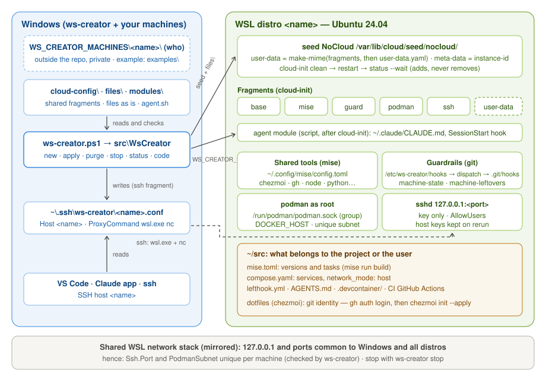

# ws-creator

WSL environment launcher: a folder describes a machine, ws-creator builds it (cloud-init,
then a few scripts), evolves it and deletes it.

    ws-creator new    <machine> [-Apply]                 creates the distro (from the image if there is one) and applies everything
    ws-creator apply  <machine> [-Only a,b] [-Apply]     reapplies fragments and modules on an existing distro
    ws-creator purge  <machine> [-Apply] [-Force]        deletes the distro (then new to rebuild it)
    ws-creator stop   <machine> [-Apply]                 stops cleanly (containers, then the distro)
    ws-creator image  <machine> [-Apply]                 builds the image <machine>.tar (base + mise)
    ws-creator status <machine>                          distro, disk, cloud-init, containers, gh
    ws-creator code   <machine>                          opens VS Code on the machine's ~/src
    ws-creator doctor                                    WSL, network, Falcon, conflicts, key permissions
    ws-creator list                                      machines and distros

Without `-Apply`: dry run, nothing is executed. `purge` also asks you to type the machine's
name, and refuses while unpushed work remains in `~/src` or `~/scratch` (uncommitted
changes, unpushed commits, stash) unless `-Force`. `new`, `apply` and `image` print how
long they took.

Access: `ssh <machine>` (alias written by ws-creator with the ssh fragment), VS Code
Remote-SSH, or the Claude app with the same host. The distro starts on connection.



## Install

Requirements: Windows 11, WSL 2 in mirrored networking mode, PowerShell 7.4+.

```powershell
Install-PSResource WsCreator        # PowerShell Gallery (or: Install-Module WsCreator)
ws-creator doctor
```

`ws-creator` is the alias of `Invoke-WsCreator`; each subcommand is also a function
(`Get-Command -Module WsCreator`, `Get-Help New-WsCreatorMachine`). Update:
`Update-PSResource WsCreator`. From a clone, without installing: `.\ws-creator.ps1 <command>`.

## Get started

The module holds the tool, not your machines: `examples/` has one to copy.

| What | Where, by default | Variable to change it |
|---|---|---|
| your machines (config, to keep in a private repo) | `%APPDATA%\ws-creator\machines` | `WS_CREATOR_MACHINES` |
| base images (rebuildable) | `%LOCALAPPDATA%\ws-creator\images` | `WS_CREATOR_IMAGES` |
| distro disks | `Location` in each `machine.psd1` | — |

```powershell
$machines = "$env:APPDATA\ws-creator\machines"
New-Item -ItemType Directory -Force $machines | Out-Null
Invoke-WebRequest https://github.com/akramgassem/ws-creator/archive/refs/heads/main.zip -OutFile $env:TEMP\wsc.zip
Expand-Archive $env:TEMP\wsc.zip $env:TEMP\wsc -Force
Copy-Item -Recurse $env:TEMP\wsc\ws-creator-main\examples\agent-sandbox $machines
# in the copy: the key from ~\.ssh\id_ed25519.pub in user-data.yaml, Location in machine.psd1
ws-creator new agent-sandbox            # dry run
ws-creator new agent-sandbox -Apply
```

## Layout

Three things, three formats, no template engine. The module is self-contained: it ships its
fragments, files and scripts (paths below are relative to `src/WsCreator/`).

| Folder | Holds | Format |
|---|---|---|
| `<WS_CREATOR_MACHINES>/<name>/` | **who**: a machine (the folder name is the distro name), outside the module; example in `examples/` | `machine.psd1`, `user-data.yaml`, `files/` |
| `cloud-config/` | **how**: shared fragments, without variables | cloud-config |
| `files/` | **what**: files copied as is, path = destination (`files/usr/local/bin/x` -> `/usr/local/bin/x`) | text files |
| `modules/` | what cloud-init cannot express (agent) | bash |
| `Public/`, `Private/` | the tool: one command = one function in `Public/`, building blocks in `Private/` | PowerShell module |
| `tests/` (repo root) | module tests | Pester |

## A machine (`<WS_CREATOR_MACHINES>/<name>/`)

- **`machine.psd1`**: the Windows side only, and the values that must be unique across
  machines (ws-creator checks them).

  | Key | Required | Role |
  |---|---|---|
  | `BaseDistribution` | yes | WSL image (`wsl --list --online`) |
  | `Location` | yes | folder of the virtual disk (`<Location>\<name>`) |
  | `CloudConfig` | yes | fragments from `cloud-config/`, in order (`user-data.yaml` comes last) |
  | `Modules` | no | scripts from `modules/`, run after cloud-init, in order |
  | `PodmanSubnet` | with `podman` | /24 subnet for containers, **unique per machine** |
  | `Ssh` | with `ssh` | `Port` (**unique per machine**), `PublicKey` (in `~\.ssh`): Windows SSH alias |
  | `AgentInstructions` | no | file in this folder (e.g. `AGENTS.md`) -> `~/.claude/CLAUDE.md` (agent module) |

- **`user-data.yaml`**: plain cloud-config, specific to the machine: `users` (and so the
  permissions: `sudo` group and `sudo` rule, or `sudo: null`), `/etc/wsl.conf` (hostname,
  default user, Windows disk, interop), extra packages, mise config
  (`~/.config/mise/config.toml`, `defer: true`). ws-creator reads the user from it
  (`default=` in `wsl.conf`) and checks it is in `users`, and that `hostname=` is the folder
  name. With the `ssh` and `podman` fragments, it also holds the machine's unique values,
  which ws-creator checks against `machine.psd1`: `Port` and `AllowUsers`
  (`/etc/ssh/sshd_config.d/60-ws-creator-machine.conf`), the `Ssh.PublicKey` key
  (`ssh_authorized_keys`, without its comment), `default_subnet`
  (`/etc/containers/containers.conf.d/60-ws-creator-machine.conf`), and the user's `podman`
  group (socket access, so root rights).
- **`files/`**: system files specific to the machine, e.g. `etc/ws-creator/guard.conf` and
  `etc/ws-creator/denylist.sha256` (ignored by git). Never under `/home`: the folder would be
  created as root before the user exists; what goes to the user goes through `user-data.yaml`.
- Nothing personal in a machine: the git identity and the user's config live in their
  dotfiles (below).

## Personal config: dotfiles (chezmoi)

The git identity, the default branch and `gh` as credential helper live in a dotfiles repo
managed by [chezmoi](https://www.chezmoi.io/): they follow the user to all their machines
(and to Codespaces), ws-creator knows nothing about them. On a new machine:

    gh auth login
    chezmoi init --apply <account>    # asks once for the git name and email

chezmoi is a tool in the machine's mise config. The repo is private: cloud-init cannot clone
it at boot (no credentials), hence these two commands, which `machine-state` reminds you of
until they have been run. What describes the machine (its `AGENTS.md`, its hooks) stays in
ws-creator.

## Fragments and modules

| Name | Kind | Does |
|---|---|---|
| `base` | cloud-config | base packages, journald, linger |
| `mise` | cloud-config | mise and the tools in its config, shims for non-interactive shells |
| `guard` | cloud-config | the machine's git hooks (`/etc/ws-creator/hooks`), permissions of `machine-state`, `machine-leftovers`, `machine-crumbs`, `machine-prune-branch` |
| `podman` | cloud-config | podman as root, podman system group, socket open to the group, Docker compatibility |
| `ssh` | cloud-config | sshd on `127.0.0.1` only, no password; ws-creator writes the Windows SSH alias |
| `agent` | script | `~/.claude/CLAUDE.md`, `/tidy` skill, `SessionStart` hook -> `machine-state`, `allow` rule for `machine-prune-branch`, `~/src`, `~/scratch` |

The machine's user is uid 1000: the shared fragments find it with `getent passwd 1000`,
without knowing it.

Services (databases, emulators): the machine starts none. Each project declares them in its
`compose.yaml` and starts them itself (`docker compose up -d`, or a mise task). With WSL
mirrored, a port published by podman (`ports:`) cannot be reached from the machine: the
`compose.yaml` uses `network_mode: host`, and the port is set in the service's command.

## Provisioning with cloud-init

1. ws-creator copies `files/`, then `<WS_CREATOR_MACHINES>/<name>/files/`, into the distro,
   and writes `/etc/ws-creator-profile`.
2. It puts the `CloudConfig` fragments, then `user-data.yaml`, in
   `/var/lib/ws-creator/cloud-config/`, validates them one by one (`cloud-init schema`), and
   assembles them (`cloud-init devel make-mime`) into a NoCloud seed; `meta-data` only holds
   the `instance-id`. `merge_how: 'dict(recurse_array,no_replace)+list(append)'` adds up the
   lists (`packages`, `write_files`, `runcmd`) from one fragment to the next.
3. `cloud-init clean --logs`, distro stop, `cloud-init status --wait`. `WARNING`/`ERROR`
   lines from the log are shown, and any status other than `done` stops ws-creator.

- `files/etc/cloud/cloud.cfg.d/99_zz-ws-creator.cfg` limits the sources to NoCloud (no
  reading of `%USERPROFILE%\.cloud-init` through `/mnt/c`); the `cloud-init.disabled`
  marker, left by Ubuntu's first-run setup, is removed before each run.
- **cloud-init adds, it never removes**: a rerun (`apply`) does not take back a permission
  and removes no package or file. For that: `purge`, then `new` (immutable infrastructure).
  `runcmd` runs again on each rerun: its commands check before acting.

## Guardrails (guard fragment)

They live in git and in commands, not in an agent: they hold for a human, Claude, Codex or
VS Code. An agent only has a thin adapter (the agent module's `SessionStart` hook calls
`machine-state`).

- `machine-state` (`files/usr/local/bin/`): containers, `gh`, branch and local state of each
  repo in `~/src` and `~/scratch`, and the number of crumbs (`machine-crumbs --local --summary`).
- `machine-leftovers` (`files/usr/local/bin/`): what a purge would lose. `!` lines
  (changes, stash, commits on no remote branch): exit 1, `purge` refuses. `·` lines:
  `~/scratch` outside git, for the record. `purge` and `status` run this same script.
- `machine-crumbs`: what sessions left behind that clutters without being lost. `~` lines,
  exit 0 (purge does not count them). `[gone]` branches, worktrees that are gone or in the
  scratchpad (`/tmp/claude-<uid>/<project>/<session>/`) of an ended session, listening
  servers whose current folder was deleted, `~/scratch/<topic>` whose README calls itself
  throwaway and that nothing has changed for `CRUMBS_SCRATCH_DAYS` days (7, `guard.conf`),
  containers whose compose project is gone. Without `--local`, it adds branches whose PR is
  merged (`gh`, one request per branch) and servers started by the calling session. A session
  is alive if the process of its `~/.claude/sessions/<pid>.json` is still running.
- `machine-prune-branch <repo> <branch>`: deletes the branch, local and on origin, if and
  only if its PR is merged, none is open, and all its commits are in the PR (squash merges
  included); never the main branch or a branch checked out in a worktree. `--check`: the
  verdict only. The agent module allows it without confirmation (`permissions.allow`): an
  explicit rule wins over the auto mode classifier, which refuses `git branch -D` and
  `git push --delete`.
- `/tidy` skill (`files/usr/local/share/ws-creator/claude/skills/`, put in place by the agent
  module): runs `machine-crumbs`, picks up what belongs to the session or to nobody, asks
  before a scratch folder or a container, leaves alone what belongs to another active
  session, and ends with `machine-leftovers`. No `Stop` hook: it would fire on every turn.
- Hooks (`files/usr/local/lib/ws-creator/git-hooks/`): system `core.hooksPath` ->
  `/etc/ws-creator/hooks`, each hook is a link to `dispatch`, which runs the ws-creator check,
  then the repo's `.git/hooks/<name>`. A repo-level `core.hooksPath` (husky) replaces the
  machine's hooks. Bypass: `git ... --no-verify`.
  - Hooks declared in a repo: they must go in `.git/hooks`, which `dispatch` calls. Otherwise
    lefthook installs itself in the machine's `core.hooksPath`: install it with
    `GIT_CONFIG_COUNT=1 GIT_CONFIG_KEY_0=core.hooksPath GIT_CONFIG_VALUE_0="$(git rev-parse --path-format=absolute --git-common-dir)/hooks" lefthook install`,
    and `no_auto_install: true` in `lefthook.yml` (otherwise it tries to replace the
    machine's hooks when its config changes). pre-commit (the framework) refuses to install
    when `core.hooksPath` is set.
  - `pre-commit`: `gitleaks` on the index, forbidden names in added lines and file names.
  - `commit-msg`: AI attribution (if `NO_AI_ATTRIBUTION=true`), forbidden names.
  - `pre-push`: refuses a branch whose GitHub PR is merged (no open PR). Without `gh` or
    without network, lets it through.
- Settings: `<WS_CREATOR_MACHINES>/<name>/files/etc/ws-creator/guard.conf`
  (`NO_AI_ATTRIBUTION`, `DENYLIST_EXCLUDE`, `owner/repo` patterns); without it, attribution
  is allowed and nothing is excluded.
- Forbidden names: `<WS_CREATOR_MACHINES>/<name>/files/etc/ws-creator/denylist.sha256`
  (private), sha256 hashes of lowercase words or word pairs, one per line, `#` for comments.
  Hash of a word:
  `-join ([Security.Cryptography.SHA256]::HashData([Text.Encoding]::UTF8.GetBytes('word')) | % { $_.ToString('x2') })`.
  Does not apply to repos whose `origin` matches `DENYLIST_EXCLUDE` (e.g. `owner/*`).

## Module contract (scripts)

- `modules/<m>.sh` runs as root in the distro and receives the `machine.psd1` values as
  `WS_CREATOR_*` variables (checked at the top with `: "${VAR:?}"`), including
  `WS_CREATOR_USER`.
- `modules/lib.sh` is prepended to each module: `user_home`, `as_user`. Line numbers in a
  bash error therefore include those of lib.sh.
- A module can be rerun: `apply` may run it again without damage. What the machine provides
  (`AgentInstructions`, authorized key) is rewritten on every run:
  `<WS_CREATOR_MACHINES>/<name>/` is the source of truth.
- To act as the user: `sudo -u "$WS_CREATOR_USER" -H`, never `-i` (`-i` goes through
  pam_systemd and causes systemd errors).
- No secrets in `WS_CREATOR_*`: the variables are visible in `ps`. Secrets are born in the
  distro (`gh auth login`, `aws sso login`) and die with it.
- `/etc/ws-creator-profile` marks a distro created by ws-creator; `purge` refuses without it.

## Developing ws-creator

```powershell
Invoke-Pester -Path tests                                                    # Pester 5+
Invoke-ScriptAnalyzer -Path src -Recurse -Settings PSScriptAnalyzerSettings.psd1
```

The tests cover what does not touch WSL: reading and validating machines, `apply`'s `-Only`
selection, conflicts, SSH config, the structure rules (no Jinja, Linux line endings in
`files/`, nothing under `/home`), and the machine in `examples/`. The rest is tried on a
throwaway machine (`<WS_CREATOR_MACHINES>/<test>/`, then `wsl --unregister`).

## Usage rules

- **Stop with `ws-creator stop`, never with `wsl --terminate`**: the distros share WSL's
  network stack, and a killed container leaves its NAT rules active. If it happened:
  `wsl --shutdown` (stops all distros).
- **Ports and subnets unique per machine** (`Ssh.Port`, `PodmanSubnet`, and the ports of
  the projects' services): with WSL mirrored, Windows and all distros share them. A port
  already taken on the Windows side (e.g. a local Postgres on 5432) is taken for the
  machines too. `new`/`apply` refuse a duplicate SSH port or subnet; two projects that
  start a service on the same port, on two machines at once, conflict.
- **Base image** (`image`): fresh distro + the `base` and `mise` fragments (and
  `user-data.yaml`), without key, token, sshd or service. Rebuild it when packages or tools
  change a lot (cloud-init catches up on the differences, but more slowly).
- **After `purge`**: revoke the GitHub token (Settings > Applications > GitHub CLI), unless
  it was created with `gh auth login --expiring`.
- **Isolation is the machine's, not the app's**: a Claude session keeps its Windows
  connectors (Chrome, etc.); turn them off for an agent.

## Known issues

- WSL 2.6.1: `Failed to start the systemd user session for '<user>'` at every login. Under
  an EDR that confines systemd (below), the user session really fails; no consequence for
  ws-creator, which does not depend on it.
- Workstations with an EDR such as CrowdStrike Falcon (`ws-creator doctor` detects it): it
  may put systemd under `/sys/fs/cgroup/sensor.falcon` (700, no delegated controller). Hence
  the fragments' choices, which work with or without it: no systemd user session (no linger,
  journald broadcast turned off), podman as root (socket `/run/podman/podman.sock`, podman
  group), `pids_limit = 0`, no `--memory`/`--cpus`. ws-creator does not touch the EDR's
  config.
- WSL mirrored: podman's iptables redirection to `127.0.0.1` does not work (a published
  port answers from Windows, not from the distro); the projects' services use
  `network_mode: host`.
- `CONTAINER_HOST` and `DOCKER_HOST` are in `/etc/environment` (read by PAM: ssh, VS Code;
  not by `wsl --exec`). `podman-docker` provides `docker` and `/run/docker.sock`.
- `wsl -- <cmd>` has bash reinterpret the command: use `--exec` as soon as an argument
  contains | ' $ or spaces.
- PowerShell appends a newline (`\r\n`) to everything it pipes to a program's stdin: the
  modules go through `tr -d '\r'`, and the copy of `files/` also removes the final byte.
- Windows OpenSSH requires private ACLs: the private key and `~\.ssh\ws-creator` must be
  accessible only by the user and SYSTEM.
- `ssh <machine> 'cmd'` without `-t`: staircase output in the Windows console.
- Ubuntu's `~/.bashrc` stops early for non-interactive shells (`ssh 'cmd'`): the mise shims
  are added at the top, `mise activate` stays at the end of the file.
- From a clone, `pwsh -File ws-creator.ps1 ... -Only a,b` passes `a,b` as a single value:
  run `.\ws-creator.ps1` from a PowerShell session, or the installed `ws-creator` command.

## License

[MIT](LICENSE)
