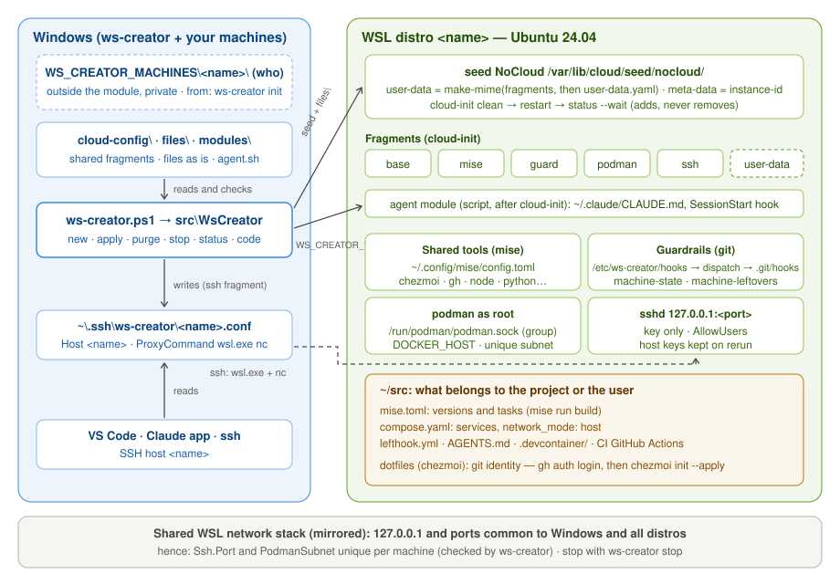

## Three things, three formats

| Part | Holds | Format |
|---|---|---|
| a machine (`<WS_CREATOR_MACHINES>/<name>/`) | **who**: one machine, outside the module | `machine.psd1`, `user-data.yaml`, `files/` |
| fragments (`cloud-config/`) | **how**: shared, without variables | cloud-config |
| files (`files/`) | **what**: copied as is, path = destination | text files |
| modules (`modules/`) | what cloud-init cannot express | bash |
| templates (`templates/`) | starting points for `init` | machine folders |

There is no template engine: every file is the real thing, readable and testable as is.
The module is self-contained and ships its fragments, files, modules and templates.

## Provisioning with cloud-init

1. ws-creator copies `files/`, then the machine's own `files/`, into the distro, and writes
   `/etc/ws-creator-profile`.
2. It puts the machine's fragments, then its `user-data.yaml`, in
   `/var/lib/ws-creator/cloud-config/`, validates each one (`cloud-init schema`), and
   assembles them (`cloud-init devel make-mime`) into a NoCloud seed; `meta-data` only holds
   the `instance-id`.
3. `cloud-init clean --logs`, distro restart, `cloud-init status --wait`. `WARNING` and
   `ERROR` lines from the log are shown; any status other than `done` stops ws-creator.
4. The modules run, then ws-creator writes the Windows SSH alias and stops the distro.

`files/etc/cloud/cloud.cfg.d/99_zz-ws-creator.cfg` limits the sources to NoCloud (no reading
of `%USERPROFILE%\.cloud-init` through `/mnt/c`), keeps the hostname from `wsl.conf`, and
keeps the SSH host keys across reruns. The `cloud-init.disabled` marker left by Ubuntu's
first-run setup is removed before each run.

## Add, never remove

cloud-init adds and never removes: a rerun (`apply`) does not take back a permission and
removes no package or file. ws-creator embraces it instead of working around it: to remove
something, `purge`, then `new` (immutable infrastructure). `runcmd` runs again on each rerun,
so its commands check before acting.

## Ownership

A machine created by `init` belongs to its user: they edit it freely and reapply it.
Updating the module updates fragments, `files/` and modules, never the machines. The
design of the catalog is in [Catalog design](../../explanation/catalog-design/).
